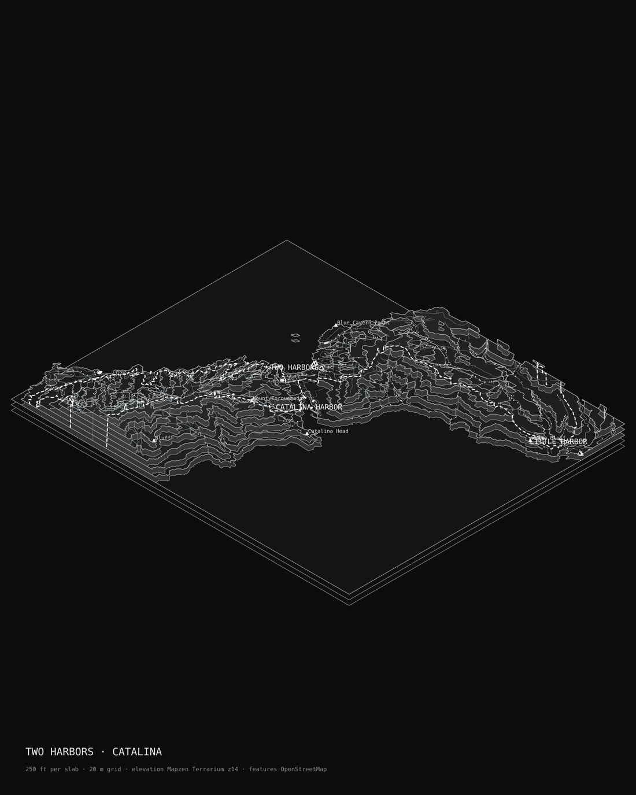
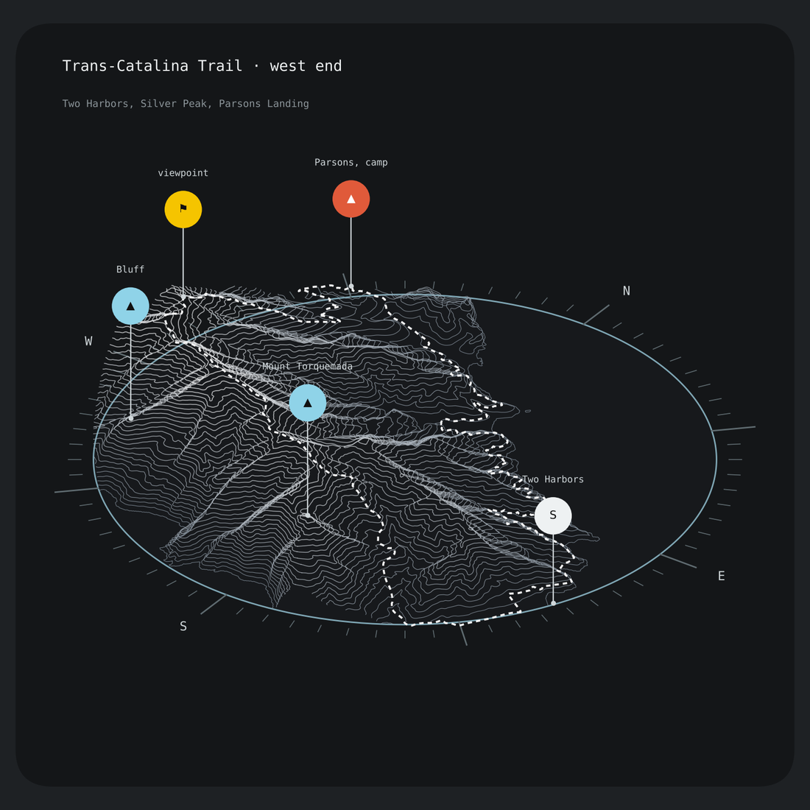
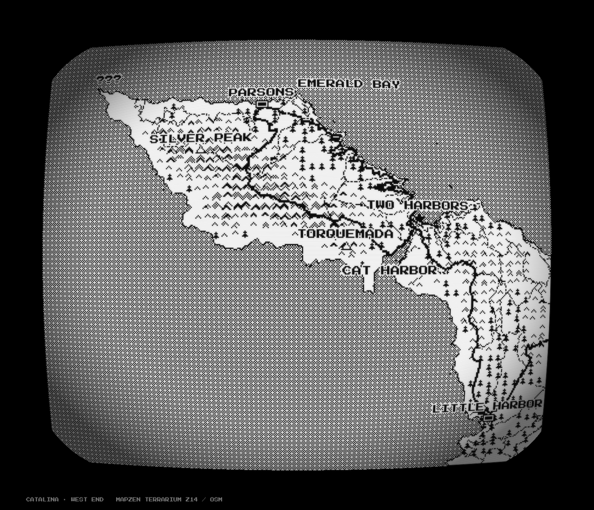
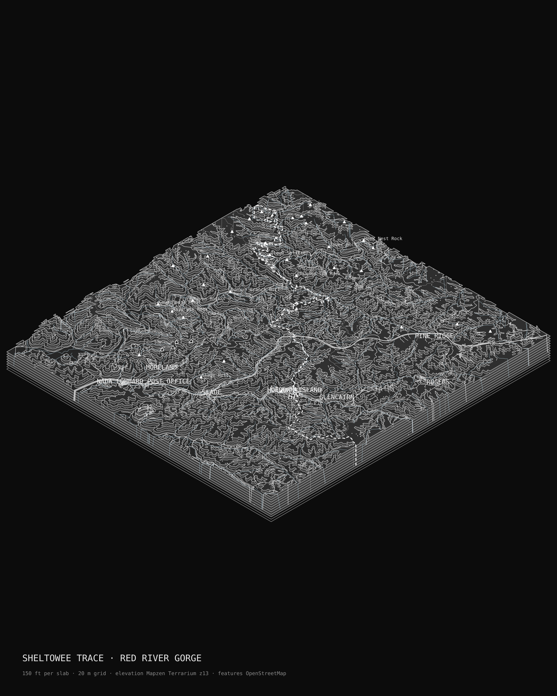
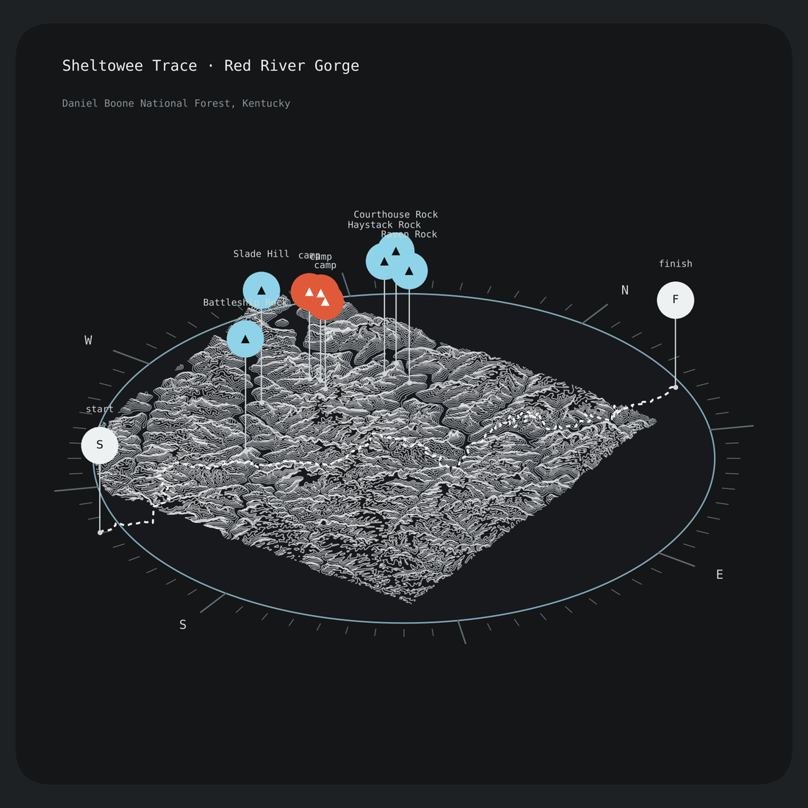
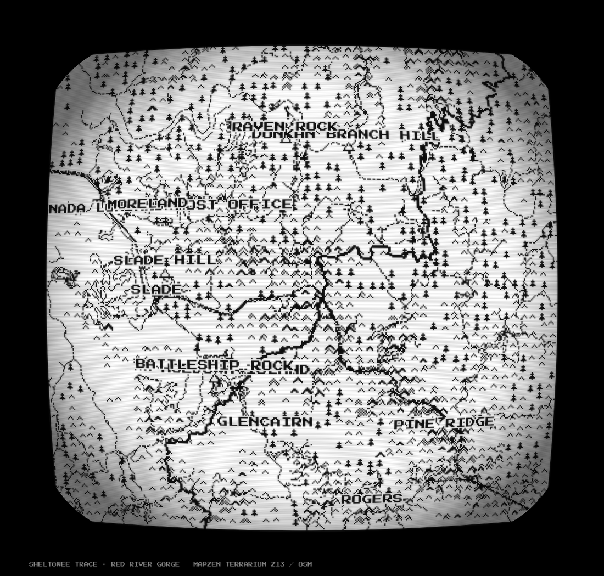

# mapgame

Stylized maps of real trails, built from open data. One scene (an elevation grid, OpenStreetMap vectors,
the trail), three looks. Works for any bbox on Earth with nothing cached: terrain comes from Mapzen
Terrarium tiles on AWS, features from the OpenStreetMap API, the trail from its OSM route relation.

| `iso` stacked laser-cut slabs | `wire` contour wireframe card | `crt` 1-bit pixel map on a CRT |
|---|---|---|
|  |  |  |
|  |  |  |

Top row: Two Harbors, Catalina Island. Bottom row: the Sheltowee Trace through Red River Gorge, Kentucky.

## Run

    pip install -r requirements.txt
    python render.py iso isthmus out/isthmus.png
    python render.py wire catalina out/catalina.png
    python render.py crt sheltowee out/sheltowee.png

Any place, by bbox and the trail's name in OSM:

    python render.py wire any out/rrg.png --bbox -83.74 37.74 -83.58 37.86 --trail "Sheltowee" --title "RED RIVER GORGE"

Options: `--zoom 14` for about 10 m terrain (13 is about 19 m), `--dem file.tif` to use a local GeoTIFF such as a
USGS 3DEP tile instead of tiles, `--step-ft 250` for thicker slabs, `--res` for the grid size in metres.
Downloads are cached under `data/` (or `$MAPGAME_DATA`). Named scenes with labels and pins live in `mapgame/scenes.py`.

## How it works

- `mapgame/area.py` rasterises a lon/lat bbox onto the local UTM zone and holds the dimetric projection.
- `mapgame/dem.py` decodes Terrarium tiles (`R*256 + G + B/256 - 32768`) and reprojects them, or reads a GeoTIFF.
- `mapgame/osm.py` fetches the bbox from the plain OSM API in small tiles (no Overpass needed), parses buildings,
  streams, roads, trails, coastline, piers, forest, peaks, camps, springs and place names, pulls the trail out of
  its hiking-route relation, and builds a land mask from coastline ways (land is on the left of each). Terrain tiles
  blend bathymetry near shore, so the mask comes from the coastline, not from a height threshold.
- `mapgame/styles/iso_stack.py` turns `height >= level` masks into polygons per band and stacks them as slabs with
  the features on the slab they belong to. The same polygons would drive a laser cutter.
- `mapgame/styles/wire_card.py` runs marching squares at a fixed interval, projects the contours with a tilted
  camera, drapes the route, and plants pins on a compass disc.
- `mapgame/styles/crt_map.py` draws one elevation cell per pixel at low resolution, hatches the upper part of
  the local relief with carets, places tree glyphs on forest polygons (or along streams), dots the trails, labels in
  Press Start 2P, then dithers the sea, adds scanlines, barrel distortion, bloom and a frame.

## Data

USGS 3DEP (optional, via `--dem`) · Mapzen Terrarium terrain tiles, hosted by AWS Open Data · © OpenStreetMap
contributors, ODbL · Press Start 2P, SIL Open Font License. Trees on Catalina are a stand-in along streams because
OSM has no forest polygons there; use NLCD or ESA WorldCover for real cover.

## Ideas

Fog of war that reveals contours as you walk. "???" for places you have not reached. Real water sources, shelters
and road crossings as mechanics. A per-section card for every shelter-to-shelter leg of a long trail. Export the
slab polygons to DXF and cut the model.

MIT.
