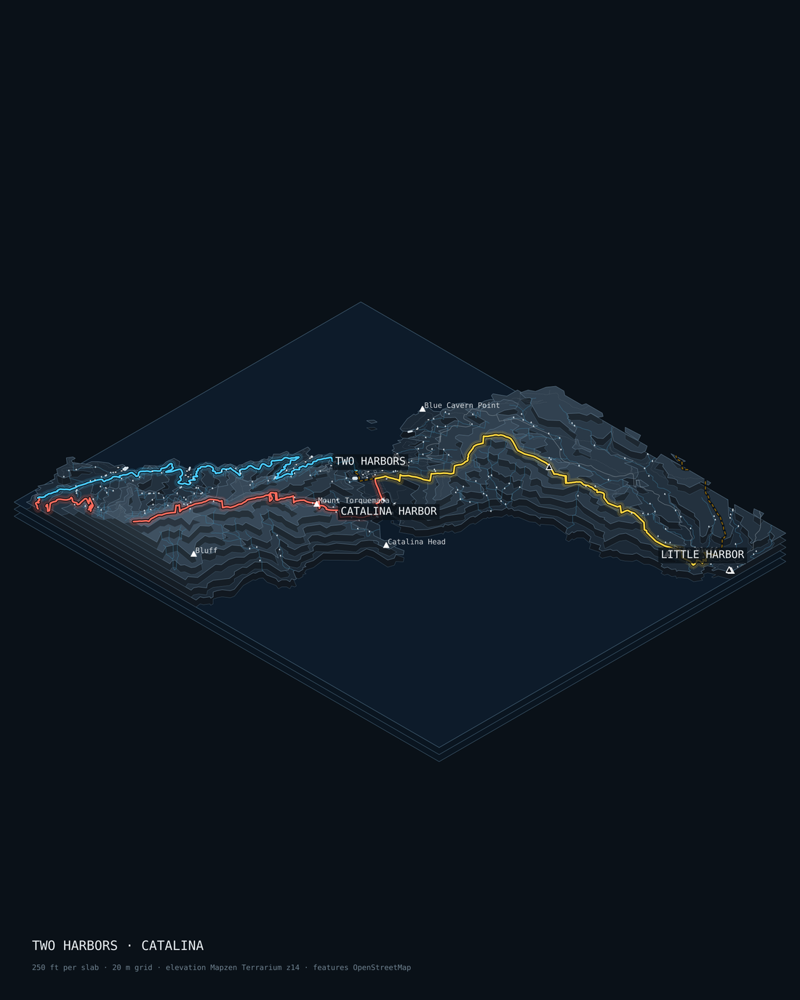
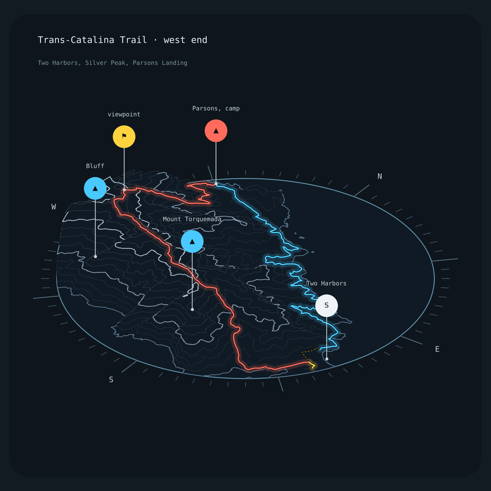
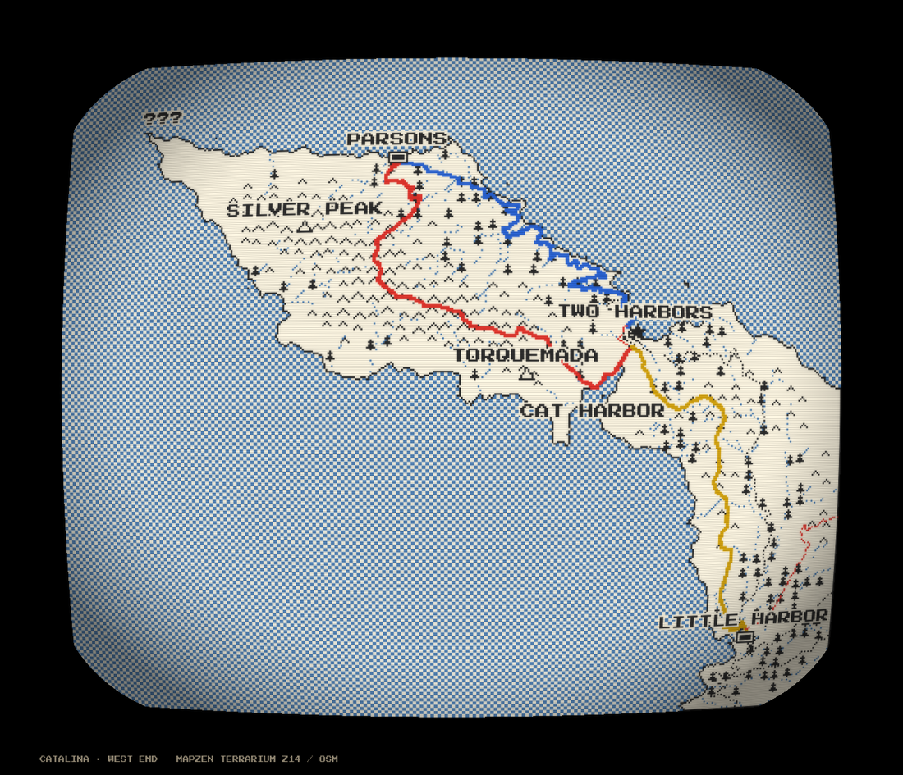
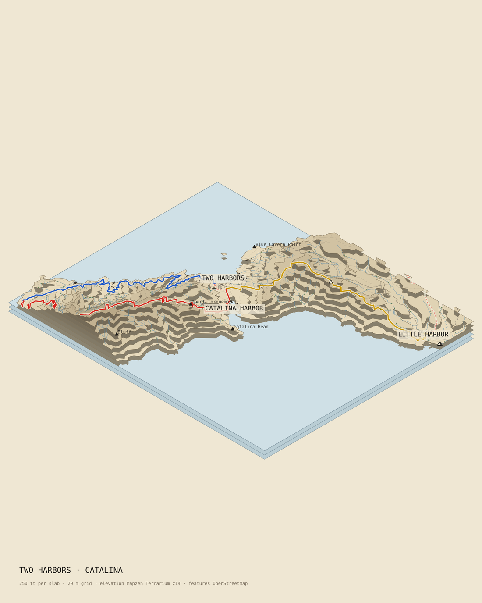
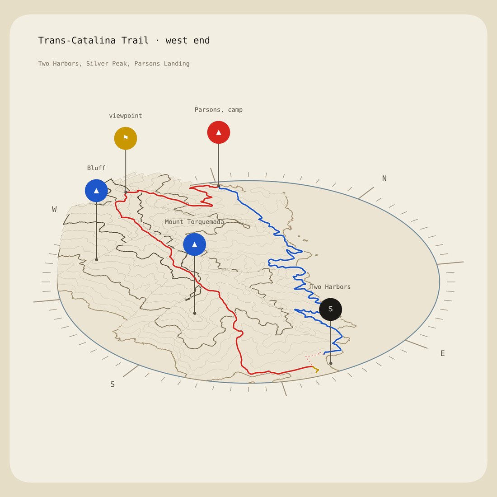
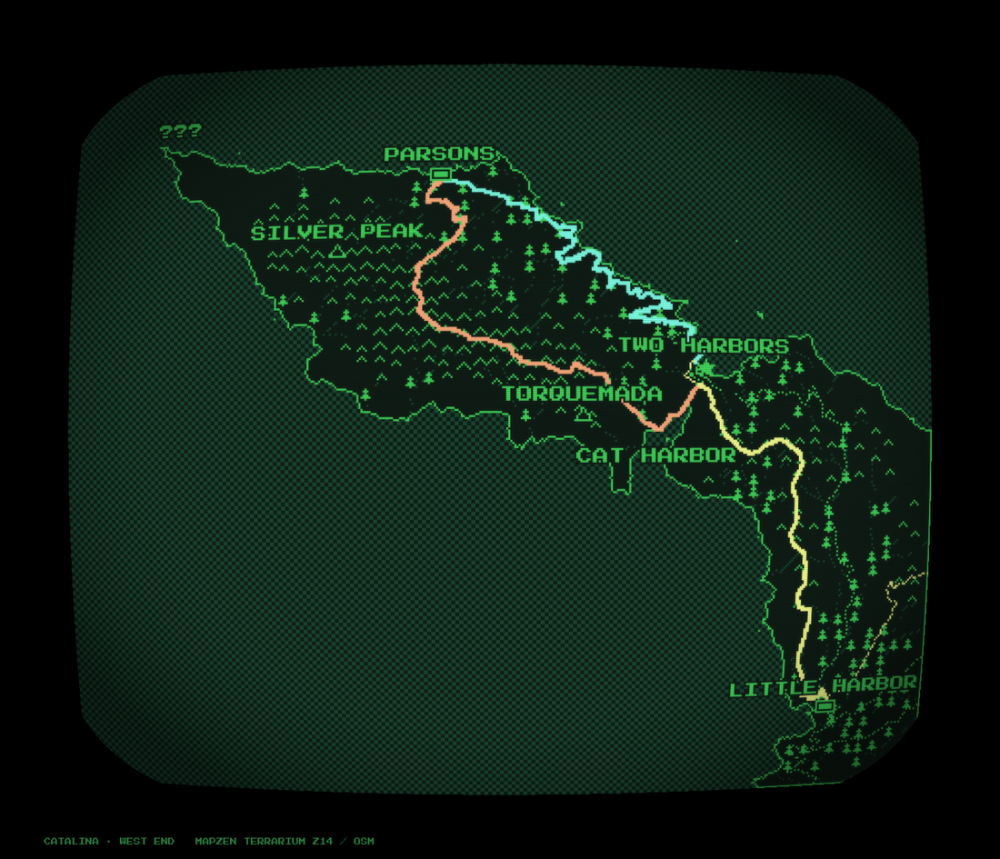
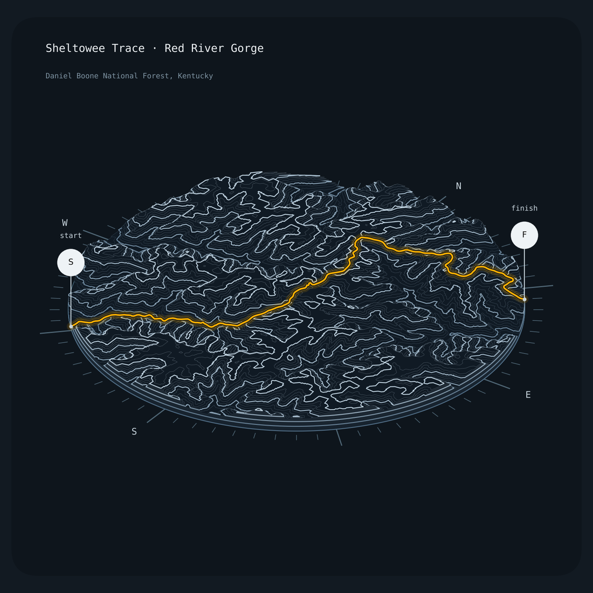
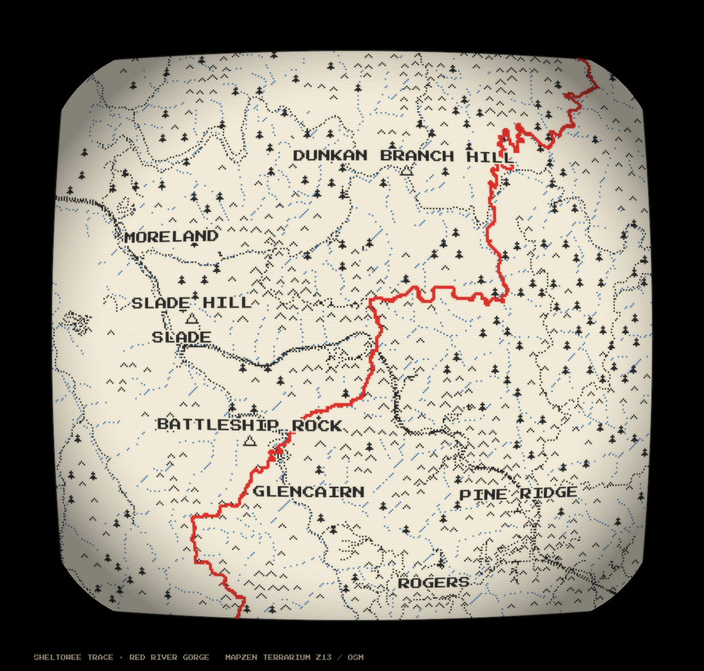
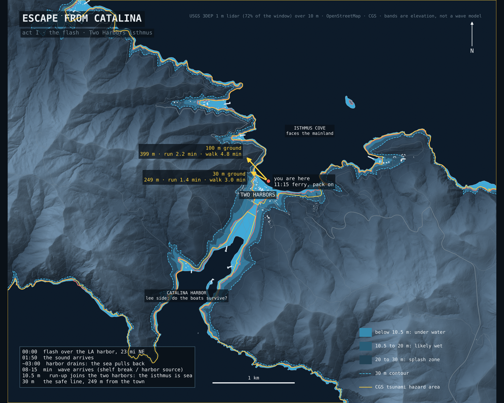
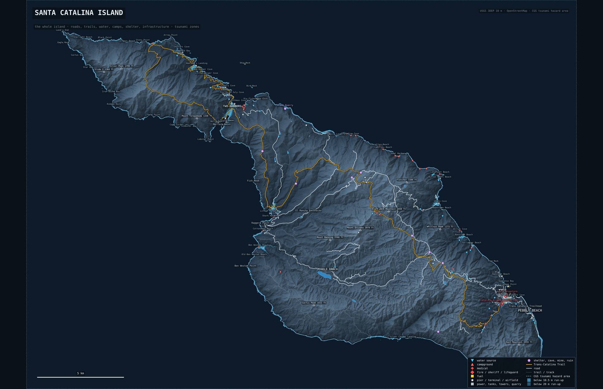

# mapgame

Stylized maps of real trails, built from open data. One scene (an elevation grid, OpenStreetMap vectors,
the trail), three looks. Works for any bbox on Earth with nothing cached: terrain comes from Mapzen
Terrarium tiles on AWS, features from the OpenStreetMap API, the trail from its OSM route relation.

| `iso` stacked laser-cut slabs | `wire` contour card | `crt` pixel map on a CRT |
|---|---|---|
|  |  |  |
|  |  |  |
|  |  |  |

Rows: Catalina in the `night` palette, Catalina in `paper` (and the `phosphor` CRT), the Sheltowee Trace through Red
River Gorge, Kentucky. Red is Monday over the ridge, blue Tuesday on the coast road, yellow Wednesday to Two Harbors.

## Run

    pip install -r requirements.txt
    python render.py iso isthmus out/isthmus.png --palette night
    python render.py wire catalina out/catalina.png --palette paper
    python render.py crt sheltowee out/sheltowee.png --palette ink

Any place, by bbox and the trail's name in OSM:

    python render.py wire any out/rrg.png --bbox -83.74 37.74 -83.58 37.86 --trail "Sheltowee" --title "RED RIVER GORGE"

Options: `--zoom 14` for about 10 m terrain (13 is about 19 m), `--dem file.tif` to use a local GeoTIFF such as a
USGS 3DEP tile instead of tiles, `--step-ft 250` for thicker slabs, `--res` for the grid size in metres,
`--focus LON LAT RADIUS_M` to put one leg of the trail on the wire card instead of the whole bbox, `--palette`
(`mono`, `night`, `paper`; the CRT also takes `ink` and `phosphor`), `--route-color #hex` to override the route.
Downloads are cached under `data/` (or `$MAPGAME_DATA`). Named scenes with labels and pins live in `mapgame/scenes.py`.

## How it works

- `mapgame/area.py` rasterises a lon/lat bbox onto the local UTM zone and holds the dimetric projection.
- `mapgame/dem.py` decodes Terrarium tiles (`R*256 + G + B/256 - 32768`) and reprojects them, or reads a GeoTIFF.
- `mapgame/osm.py` fetches the bbox from the plain OSM API in small tiles (no Overpass needed), parses buildings,
  streams, roads, trails, coastline, piers, forest, peaks, camps, springs and place names, pulls the trail out of
  its hiking-route relation, and builds a land mask from coastline ways (land is on the left of each). Terrain tiles
  blend bathymetry near shore, so the mask comes from the coastline, not from a height threshold.
- `mapgame/styles/iso_stack.py` turns `height >= level` masks into polygons per band and stacks them as slabs with
  the features on the slab they belong to. The same polygons would drive a laser cutter.
- `mapgame/styles/wire_card.py` runs marching squares at a fixed interval, projects the contours with a tilted
  camera, drapes the route, and plants pins on a compass disc.
- `mapgame/styles/crt_map.py` draws one elevation cell per pixel at low resolution, hatches the upper part of
  the local relief with carets, places tree glyphs on forest polygons (or along streams), dots the roads, labels in
  Press Start 2P, then composites separate ink layers (map, water, route) onto paper and adds scanlines, barrel
  distortion, bloom and a frame. The `mono` palette collapses it to the 1-bit original.
- `mapgame/palette.py` holds the palettes; `mapgame/route.py` cuts the route into legs along an itinerary.

## Color

Every palette keeps terrain and features desaturated so the route is the only saturated thing on the page: it
stands out by saturation and luminance, not just hue. Dark palettes add a soft glow in the route's own hue outside
a dark casing; light palettes use a paper casing instead. A scene can carry an itinerary, `stops` in order with
`leg_days`, and the route is cut wherever a stop lies on it; a piece whose ends sit at consecutive stops is that
day's leg and takes that day's color. Two paths between the same two towns (a ridge and a coast road) are told
apart by a via-point on each. Trail that exists but is not on the plan is drawn as a muted dash.

## Readability rules the styles follow

One hero per image: the route is the only bright line, everything else is one quiet grey. Terrain reads by value
(slab tops lighten with height; the wire body is filled so nothing shows through a ridge), not by outline. Lines
have a hierarchy: index contours every fourth, the rest faint. Hatching marks only the upper third of the local
relief, on slopes, thinned to a checkerboard, so white space does the work. Labels and pins are capped, never
overlap, and the highest named summits win. A dissected plateau needs a focus disc, not a whole region.

## Data

USGS 3DEP (optional, via `--dem`) · Mapzen Terrarium terrain tiles, hosted by AWS Open Data · © OpenStreetMap
contributors, ODbL · Press Start 2P, SIL Open Font License. Trees on Catalina are a stand-in along streams because
OSM has no forest polygons there; use NLCD or ESA WorldCover for real cover.

## Ideas

Fog of war that reveals contours as you walk. "???" for places you have not reached. Real water sources, shelters
and road crossings as mechanics. A per-section card for every shelter-to-shelter leg of a long trail. Export the
slab polygons to DXF and cut the model.

MIT.

## The game scenario

`scenario/` works out Escape from Catalina from real data: wave travel times across the channel, the run-up that
turns the isthmus into sea, how far the nearest safe ground is from the pier, what the state's own tsunami hazard
line says, what high ground has water and buildings, and how far the boats would have to go. See
`scenario/README.md` for the numbers and `scenario/numbers.py` / `scenario/flood_map.py` to recompute them.

## The island atlas

`atlas/` maps the whole island for the game: 316 road segments, 465 trail and track segments, 1,910 buildings,
every food, store, water, camp, medical, emergency, pier, infrastructure and shelter feature OpenStreetMap knows,
each with its height, distance to the coast, whether the state's tsunami hazard area or a 10.5 m or 20 m run-up
reaches it, and a fallout note (open water, covered tank, solid or light building). Boats are counted on USDA
aerial imagery. Four research passes add the sourced facts a map cannot hold: moorings by cove and boat length,
people on an October day, utilities and fuel, vehicles, bunkers and mines, wildlife numbers.

- `python atlas/build.py` writes `atlas/out/features.csv`, GeoJSON layers and `summary.md`
- `python atlas/boats.py` counts hulls per cove from NAIP imagery (Planetary Computer)
- `python atlas/map.py all` renders the island sheet and the Avalon and Two Harbors sheets from 1 m lidar
- `python atlas/web.py` builds the interactive page (`atlas/out/web/index.html`)
- `atlas/FACTS.md` is the sourced digest, `atlas/GAPS.md` lists what could not be found and how to get or invent
  it, `atlas/research/` holds the raw sheets with every URL

